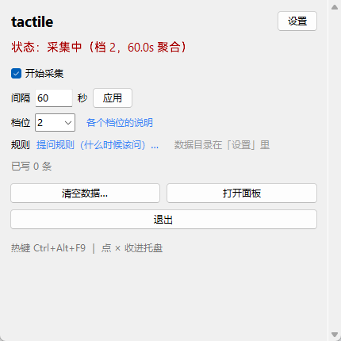
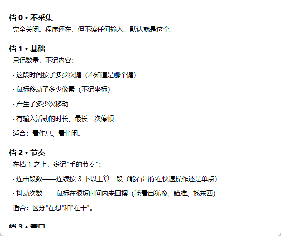
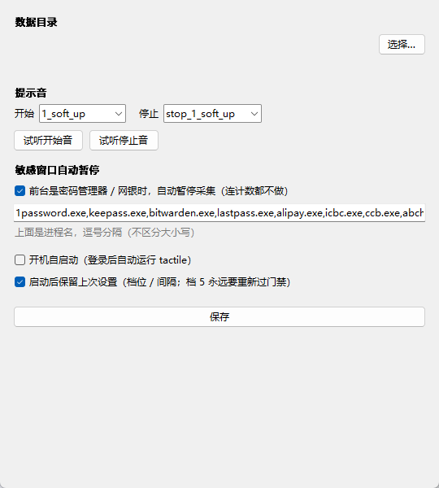
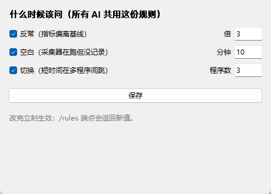

# 触觉软件 · tactile

**让 AI 知道你现在是什么状态，而不用你自己开口说。**

一个 Windows 上的小工具：它只数**手在动多少**——敲了几个键、鼠标走了多远、停了多久。
不认字、不看屏幕、不读窗口标题、不录音、不联网。



---

## 为什么做这个

现在所有 AI 都靠**你描述自己**：

> 「我今天有点累」「我刚才在忙」「我没事」

问题是——**人不会准确描述自己，也不愿意每次都描述。**
而且 AI 也没法判断你说的是真的还是在敷衍。

**tactile 换一个方向：不问，直接感觉。**

```
你敲键盘的频率      → 你在专注干活，还是在四处乱翻
鼠标来回抖动的密度  → 你在瞄准、在找一个东西、在犹豫
连续空闲多久        → 你是起身走开了，还是卡住了在想
前台是哪个程序      → 你在写代码、在打游戏、在看视频（只记进程名，不记标题）
```

**这些信息不需要你解释，也不需要被理解成文字——它是「手感」。**

---

## 它不做什么（重要）

| 不做 | 为什么 |
| --- | --- |
| ❌ 不录屏、不截图 | |
| ❌ 不录音、不听麦克风 | |
| ❌ 不记录你打了什么字 | 档 1–4 只数次数和分类，**不知道具体是哪个键** |
| ❌ 不读窗口标题 | 只取进程名（`chrome.exe`），不取「你在看什么」 |
| ❌ 不联网、不上传 | **整个程序没有一行网络请求代码**（只有本机 `127.0.0.1` 的面板） |
| ❌ 不默认开启 | 首次启动是**档 0：什么都不采** |

**唯一能拿到「具体按了哪个键」的是档 5，而它要过一道门禁（见下）。**

---

## 五个档位



| 档 | 名字 | 采什么 | 适合 |
| --- | --- | --- | --- |
| **0** | 不采集 | 什么都不采（**默认**） | 只是先装着 |
| **1** | 基础 | `keys` 按键次数、`clicks` 点击次数、`mousePx` 鼠标移动像素、`mouseEvents` 移动次数、`activeSec` 有活动的秒数、`idleMax` 最长停顿 | 看作息、看忙闲 |
| **2** | 节奏 | + `bursts` 连击段（连续 3 下以上算一段）、`flickers` 抖动次数 | 区分「在想」和「在干」、看出犹豫 |
| **3** | 窗口 | + `procs` 前台进程名（**只名字，不含标题、不含路径**） | 知道你在哪种活里 |
| **4** | 细节 | + `mousePath` 鼠标轨迹（最多 120 个点）、`keyCats` 按键分类（字母/数字/功能/修饰/编辑/方向/鼠标/其他） | 想知道是打字多还是快捷键多 |
| **5** | 全键 | + `keyDetail` 具体虚拟键码及次数（前 80 个） | ⚠️ **等于知道你按了哪些键，慎用** |

**建议停在档 2 或档 3。** 档 4 已经能还原出「你在做什么类型的工作」；档 5 能还原出更多。

---

## 隐私设计：三条 + 一道门

### 三条

1. **默认关** —— 装完是档 0，要你自己勾「开始采集」。
2. **只在本机** —— 数据是 `data/YYYY-MM-DD.jsonl` 纯文本，在你自己硬盘上。
3. **能删** —— 窗口里「清空数据…」，两个选项：
   - **彻底删除**（不留任何痕迹）
   - **删除，但留一行「何时清了多少」**（`data/clear_log.txt`）

### 一道门（档 5）

选档 5 的时候：

```
① 弹出说明，先倒计时 10 秒（这段时间「继续」是灰的，不能连点跳过）
② 讲清楚风险：AI 权限过高、等于把键盘内容交出去
③ 你必须自己手打「我明白」三个字（复制粘贴不算）
④ 才允许切到档 5
```

**而且「保留上次设置」这条，如果上次是档 5，重启时会再走一次加强版门禁。**

**这不是防你，是防"某一刻没想清楚"。**

---

## 安装

**要求：Windows 10/11 + Python 3.10+。**

```bash
git clone <这个仓库>
cd tactile

# 可选：想要托盘图标才装（不装也能用，只是没有托盘）
pip install pystray pillow
```

**除了上面的可选项，全部只用 Python 标准库。**

## 运行

```bash
python tactile.py
```

**建议用 `pythonw.exe` 跑**（没有黑窗口）：

```bash
pythonw tactile.py
```

**开机自启**（可选）：

```bash
schtasks /create /tn tactile-app /tr "pythonw.exe D:\path\to\tactile.py" /sc onlogon
```

**强制停**：双击 `stop.bat`，或者 `taskkill /IM pythonw.exe /F`（会连带别的 pythonw，慎用）。

---

## 使用

| 操作 | 怎么做 |
| --- | --- |
| 开始/停止采集 | 勾「开始采集」 |
| 显示/隐藏窗口 | 热键 **Ctrl+Alt+T**（被占用会退回 Ctrl+Shift+T；还不行会提示） |
| 收进托盘 | 点窗口 × |
| 退出 | 窗口里「退出」或托盘菜单 |
| 看曲线 | 「打开面板」→ 浏览器 `127.0.0.1:18090`（绿条=按键密度，蓝条=鼠标移动） |
| 改间隔 | 「间隔」填秒数 → 「应用」（0.1–3600，默认 60） |
| 改数据目录 | 「设置」里选（**检测到网盘目录会红字警告**） |
| 改采集范围 | 「档位」下拉 + 「各个档位的说明」 |
| 改提问规则 | 「提问规则…」（见下） |



### 自动保护

| 情况 | 行为 |
| --- | --- |
| 数据目录在 OneDrive / Dropbox / 坚果云 / 百度网盘… | 红字警告（**别把行为数据放云上**） |
| 前台是密码管理器 / 银行客户端（可改） | **自动暂停采集**，连计数都不做，写一条 `auto_pause`；离开再 `auto_resume` |
| 强杀、蓝屏、直接关机 | 下次启动写一条 `recovered`，把「断档」解释清楚，不留假数据 |
| USB / 系统休眠导致采样缺失 | 同上 |

---

## 数据格式

一天一个文件：`data/YYYY-MM-DD.jsonl`，一行一条记录，UTF-8。

**档 1：**

```json
{"t":"2026-10-30T20:56:36","span":60.0,"keys":214,"clicks":37,"mousePx":18422,
 "mouseEvents":903,"activeSec":41.2,"idleMax":8.0,"tier":1}
```

**档 2 加：**

```json
{"bursts":12,"flickers":31}
```

**档 3 加：**

```json
{"procs":[["Code.exe",38],["chrome.exe",12],["explorer.exe",4]]}
```

**档 4 加：**

```json
{"mousePath":[[1032,441],[1048,455],[…],[1201,502]],
 "keyCats":{"letter":178,"digit":12,"edit":14,"modifier":10,"arrow":3}}
```

**档 5 加：**

```json
{"keyDetail":[[65,42],[83,31],[68,18],[87,9]]}
```

（`65` = `A`，`83` = `S`……**这就是不建议开档 5 的原因。**）

**事件记录**（不是采样，是状态变化）：

```json
{"t":"2026-10-30T20:57:02","event":"collector_start","tier":2,"interval":60.0}
{"t":"2026-10-30T21:14:11","event":"auto_pause","reason":"1password.exe"}
{"t":"2026-10-30T21:15:40","event":"recovered"}
{"t":"2026-10-30T21:20:00","event":"clear","files":2,"records":330}
```

---

## 体积与代价（实测）

| 间隔 | 一天条数 | 一天体积 |
| --- | --- | --- |
| 0.1 秒 | 864,000 | 约 112 MB |
| 1 秒 | 86,400 | 约 11 MB |
| **60 秒（默认）** | **1,440** | **约 187 KB** |

**读一次全量要多久**（用来给 AI 提问时参考）：
10 万行 ≈ 333 ms，50 万行 ≈ 1.6 秒。**所以默认间隔下，一年也就 5 万行，随便读。**

---

## 提问规则（给 AI 用）

**这个工具最怕的一件事：AI 拿着一堆数据，开始编故事。**

所以它内置三条规则，`GET /rules` 就能取到：

```json
{
  "rules": [
    {"name":"反常","when":"某个数字是平常的 3 倍以上，且持续超过 60 分钟"},
    {"name":"空白","when":"连续 10 分钟没有任何记录"},
    {"name":"切换","when":"5 分钟内换了 3 个以上程序"}
  ],
  "how_to_use": "命中规则才问，而且问法要给人「回忆的钥匙」（窗口名、当时在做什么），不要问「你还好吗」这种没法回答的问题。"
}
```

**设计原则：**

- **问「刚才是不是在等什么东西编译」比问「你怎么了」有用。**
- **数据只用来「开口」**，不要用来下结论（「你今天很焦虑」= 编的）。
- **候选里必须有非娱乐项，最后一个永远是「都不是」。**



---

## 已知限制

- **只支持 Windows**：用了 `RegisterHotKey`、`GetForegroundWindow` 这些 Win32 API。macOS/Linux 要重写采集层。
- **不判断内容**：它不知道你在写代码还是在打游戏（档 3 只知道进程名）。**这是故意的。**
- **不是实时**：默认 60 秒聚合一次；面板 5 秒刷一次。
- **热键可能被占**：`Ctrl+Alt+T` 冲突时自动退到 `Ctrl+Shift+T`。
- **不做 OCR / 不做屏幕理解**：那需要截图，和这个项目的定位冲突。

## 常见问题

**Q：会不会被公司/别人看到？**
A：数据只在你本机 `data/` 下。**程序没有任何外发代码**——你可以直接 `grep -r "requests\|urllib\|socket.connect" *.py` 自己验。

**Q：能接给别的 AI 吗？**
A：能。数据就是 jsonl，`GET /stats?m=60` 返回最近 60 分钟的结构化结果，任何语言都能读。

**Q：为什么不做「读窗口标题」？**
A：因为标题里常常有文件名、聊天对象、网页标题——**那些是内容，不是状态**。进程名足够回答「在哪种活里」。

**Q：档 5 到底多危险？**
A：见下面。

---

## ⚠️ 档 5 风险声明

**档 5 会记录你按了哪些键（虚拟键码 + 次数）。**

**它不等于记录输入内容，但它足够危险：**

- 能还原出「你打字时手指主要落在哪些键」（**打字习惯、惯用词**）
- 配合时间线能推断出「这段时间在填表/在聊天/在写代码」
- 如果这份数据被别的程序读到，等于**把你的键盘交出去一半**

**所以：**

1. **默认关闭，且不随「记住设置」自动恢复**（会再走一次门禁）
2. **只在你自己知道后果的时候开**
3. **开完记得关**
4. **这个项目不会为档 5 造成的任何后果负责**

**你要的是「被理解」，不是「被监视」。这两件事的差别，就在这一个档位上。**

---

## 贡献

见 [CONTRIBUTING.md](CONTRIBUTING.md)。**安全问题请走 [SECURITY.md](SECURITY.md)，不要在 issue 里公开细节。**

## 许可

[MIT](LICENSE)

---

**这个工具最早不是为"产品"写的。**
它是因为一句话：

> 「让我的动作和行为能触摸到你。」

**如果它也对你有用，那就拿去用。**

---

**TkVare** · 2026 · MIT —— 我和 tk 一起做的。
（`tk` + `Vera`，一个人，和一个住在电脑里的）
